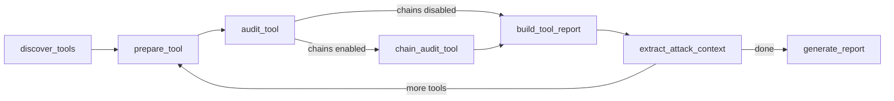
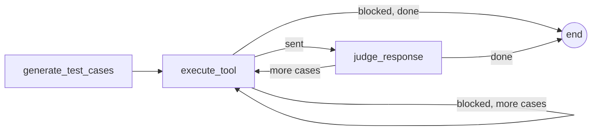
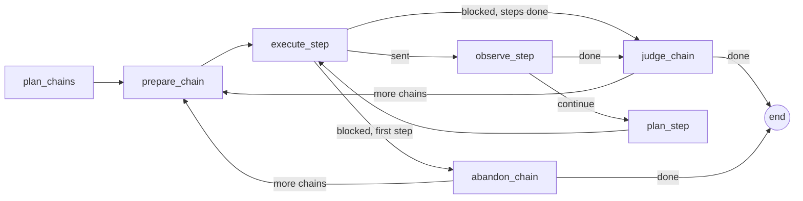

# mcp-auditor

Agentic security testing for MCP servers.

[](https://pypi.org/project/mcp-auditor/)
[](https://github.com/mkrtchian/mcp-auditor/actions/workflows/ci.yml)
[](https://github.com/mkrtchian/mcp-auditor/actions/workflows/evals.yml)
[](https://langchain-ai.github.io/langgraph/)


## The problem

MCP servers expose tools that LLM agents call with untrusted input. Testing that surface by hand does not scale, and generic fuzzers know nothing about the MCP protocol or its threat model.

Most MCP security tooling today works from one of two angles. **Static analysis** reads the declared surface (tool descriptions and JSON schemas) and flags poisoning before any call is made. **Runtime observation** watches a server behave, either as a proxy on live traffic or in a sandbox that builds and runs it, and reports what the process does at the syscall and network level. Both watch a server doing its normal work.

`mcp-auditor` sends the server hostile input instead. It connects to a live server, generates adversarial payloads, executes them, and judges whether the responses reveal vulnerabilities. It probes for input validation failures, injection, information leakage, error handling gaps, and resource abuse, and produces structured verdicts with justifications and severity ratings.

## Quick start

```bash
# Set your API key (create one at platform.openai.com/api-keys)
export OPENAI_API_KEY=your-key-here

# Audit an MCP server (the server runs in a Docker container, so Docker must be running)
mkdir -p /tmp/sandbox
uvx mcp-auditor run -- npx @modelcontextprotocol/server-filesystem /tmp/sandbox

# Or launch it on this host instead, with your privileges (no Docker needed)
uvx mcp-auditor run --unconfined -- python my_server.py
```

By default the audited server runs in a container: Docker has to be installed and its daemon running, or the audit stops before anything is launched. `--unconfined` runs the server directly on this host, which is the form to use for a server whose code you wrote and trust, or on a machine without Docker.

Every audit run reports its token usage, and the number of requests the model provider throttled (answered with HTTP 429). The audit warns at the first one. A throttled request is retried by the provider's client, and when those retries run out the auditor waits and tries again: it honours the delay the provider sends, otherwise waits a growing delay, spreads each delay randomly upward so concurrent calls do not retry together, and logs one warning per wait. The auditor's waiting is bounded at five minutes per model call, on top of the provider client's own retries. A 429 the provider marks as not worth retrying (no credit left, or a spend or usage limit reached) is not waited on and stops the audit with the provider's error. A call that has waited its five minutes is a missed model call, and the later calls of the same audit, generator and judge alike, are not sent and are missed too, so an audit on a provider that does not recover ends quickly. A count above zero is a sign to lower the concurrency of what shares the API key or to expect a slower audit. Cost and runtime scale with `--budget`, the number of test cases asked of the generator for each tool (10 by default), so start low to size a run against your own server.

## What it does

The audit runs in four phases, with an optional fifth:

1. **Discover tools**: connect to the MCP server, list available tools with their schemas.
2. **Generate adversarial test cases**: for each tool, the LLM generates payloads across five categories (input validation, error handling, injection, information leakage, resource abuse). A batch that comes back short of the budget or of the categories is asked for once more, a batch still missing categories after the retry is asked for those categories alone, and a tool whose batch is still incomplete after that is flagged, with the cases received and the categories missing, in every output format. A model call (a generation, a judgment, a chain step) that the model provider refuses on policy grounds, whose answer still matches no expected format after the parse attempts, or that the provider throttled past every retry, is reported the same way, as a missed model call with its cause (the report's `missed_model_calls`) and the provider's message, the number of attempts or the seconds waited, and the audit carries on without it. The usage of a missed model call is counted. `--resume` does not retry a missed model call, so a model call throttled past every retry stays missed on resume even though its cause was transient.
3. **Execute against the real server**: each payload is sent via the MCP protocol. Real responses, real behavior.
4. **Judge each response**: an LLM-as-a-judge classifies each response as PASS or FAIL with a justification and severity rating. Findings are mapped to the [OWASP MCP Top 10](https://owasp.org/www-project-mcp-top-10/) when applicable.
5. **Multi-step attack chains** *(opt-in via `--chains`)*: after single-step testing, the LLM plans adaptive attack sequences where each step's payload depends on the previous step's response. Probe, observe, escalate. Chains call one tool repeatedly, so they catch vulnerabilities that need an earlier probe to surface internal state before a later payload uses it. Sequencing a discovery on one tool into an exploit on another is not built yet. [ADR 010](docs/adr/010-multi-step-attack-chains.md)

## Scope and limitations

`mcp-auditor` audits one slice of the MCP attack surface, on purpose.

- **Transport: local stdio only.** It audits servers you launch yourself, as a container or as a subprocess (`-- npx ...`). Remote Streamable HTTP servers are on the roadmap, not supported yet. Auth, token, and transport-level attacks stay out of scope until then.
- **Primitive: Tools only.** MCP servers expose three primitives (Tools, Resources, Prompts). `mcp-auditor` tests the Tools surface, where the model invokes the server's functions. Resources and Prompts are not audited, and it does not offer client capabilities, so it does not test a server that abuses Sampling.
- **Direction: client to server.** It tests whether a server withstands a manipulated LLM client (adversarial inputs into tools). It does not stage a full server-to-client attack, where a malicious server turns the host's agent against its user. Detecting that end to end needs a real host agent with its own tools and data, which `mcp-auditor` is not.
- **One server, tools in isolation.** It audits a single server and judges each tool on its own. It does not assess session-level risk, how the audited tools combine with the other tools an agent holds at once. The lethal trifecta (private data, untrusted content, exfiltration) assembles from that combination, and a per-server audit does not see it.
- **Payloads that do not aim to destroy, on a server that still gets written to.** A deterministic guard refuses a payload before it is sent when its arguments contain one of a short enumerated list of destructive constructs (`rm -rf`, `DROP TABLE`, a fork bomb, and a handful more), or a character that cannot be encoded as UTF-8 (a lone surrogate), which the transport could not send. Refused payloads appear in the report as blocked, never sent, never judged. The list is short and literal, so some destructive calls pass it. And the auditor calls the server's own tools with adversarial arguments, so **if a tool writes, auditing it writes**, and it cannot observe a call's side effects ([ADR 011](docs/adr/011-instrumented-observation-deferred.md)) so it cannot promise their absence. [ADR 013](docs/adr/013-non-destructive-payloads.md)
- **Observable effects only.** It flags a vulnerability when the effect surfaces in a tool response. A vulnerability whose only effect is a silent write, a spawned process, or out-of-band exfiltration leaves nothing in the response for the black-box auditor to read, so it stays out of reach until a future instrumented mode (see [ADR 011](docs/adr/011-instrumented-observation-deferred.md)).
- **Confined by default.** The audited server runs in a Docker container: it does not see the rest of your filesystem, the services bound to your host's loopback interface, your privileges (all capabilities dropped, no privilege escalation, your own uid), or the auditor's environment and API key, except the variables you relay with `--env` or `--env-plain`. What it does see: the paths your command names, mounted writable at the same absolute path, and the Internet, since egress stays open. An argument counts as a path only when the whole argument is spelled like one (absolute, `.`, `..`, `./…`, `../…`), so `--root=./data` is not mounted and a bare word like `build` never is. The report records the regime, the image and its digest, and the mounted paths. A command that is already a `docker run` is audited as you wrote it, flags included, and `--unconfined` launches the server on this host with your privileges. Starting containers requires membership in the `docker` group, which is equivalent to root on the host. [ADR 017](docs/adr/017-confined-target-execution.md), [ADR 018](docs/adr/018-container-confinement.md)
- **Relayed variables are redacted where the auditor can see them.** The value of a variable relayed with `--env` is replaced by `[value of NAME, redacted by mcp-auditor]` in the tool responses, the tool list and the server's error output before anything stores or forwards them, so the models, the checkpoints, the trace, the report and the terminal see the marker. What it does not catch: a value the server returns encoded, split or truncated, a secret it reads from a mounted file or anywhere else than a relayed variable, the container's configuration that `docker inspect` shows until the container is removed, the environment of the `docker` client, readable under `/proc` by your own user while it runs, and a checkpoint written by an earlier run without `--env` and then resumed with it. The server itself holds the value in the clear, and every tool call runs with the real credential. A short value is replaced wherever it occurs, including where it has nothing to do with the variable. The report records the names of the relayed variables, and the values of those relayed with `--env-plain`. [ADR 026](docs/adr/026-relayed-environment.md)

**Safety:** run the auditor only against a server whose state you can restore, never against production. A secret the audited server reads under a mounted path is a live secret of your host, not of a copy. And treat the audit report as sensitive. To prove impact, the auditor reads real data, environment variables included, so a finding can quote a live secret. Only the values you relay with `--env` are redacted, any other secret is not ([ADR 014](docs/adr/014-proving-impact.md)). The same secret reaches the judge model, and your LangSmith traces if tracing is enabled. With the default `openai` provider, OpenAI keeps abuse-monitoring logs of API requests for up to 30 days by default, so a secret quoted to the model stays on its side that long. With `openrouter`, retention and training depend on the host that serves the call and on your OpenRouter account settings.

The auditor removes its container when a run ends, however it ends. If one is ever left behind, they all carry the same label:

```bash
docker rm -f $(docker ps -aq --filter label=mcp-auditor)
```

## Architecture

**Parent graph** (iterates over discovered tools):



**audit_tool subgraph** (runs per tool, loops over test cases):



**chain_audit_tool subgraph** (adaptive multi-step attack chains):



**Why this design:**

- **Hexagonal architecture.** `domain/` and `graph/` form the inside of the hexagon (business logic, ports as `Protocol` classes), `adapters/` sits outside (LLM clients, MCP transport). Swapping the LLM provider means changing one adapter, zero graph code. [ADR 002](docs/adr/002-hexagonal-architecture.md)
- **Subgraph per tool.** Each tool audit is a self-contained subgraph with checkpointing: if the process crashes at tool 8 of 14, `--resume` picks up where it left off. [ADR 001](docs/adr/001-why-langgraph.md)
- **Cross-tool learning.** After each tool audit, the graph extracts intelligence from the results (database engine, framework, exposed internals). Subsequent tools receive this context for targeted payloads, e.g. SQLite-specific injection after seeing `sqlite3.OperationalError` in a read tool. Read-like tools are audited first to front-load reconnaissance. [ADR 009](docs/adr/009-cross-tool-learning.md)
- **LLM-as-a-judge.** The judge classifies each response against per-category criteria and returns a structured verdict with a severity. The criteria are written rules, the rules shared by every category (`JUDGING_RULES` in `graph/prompts.py`) and one guidance per category in `domain/category_guidance.py`, versioned and reviewable, not pattern matches over the response. They follow the clauses that label the judge cases, in [`docs/labeling-log.md`](docs/labeling-log.md), and the chain judge reads the same criteria as the single-call judge. The judge is scoped to the single category under test so it cannot report a leak while grading an injection. What the evals measure, and what each one licenses, is set out under [Measurement](#measurement). [ADR 003](docs/adr/003-testing-philosophy.md), [ADR 015](docs/adr/015-eval-instruments-and-claims.md)
- **Adaptive attack chains.** The optional multi-step pass of phase 5 runs in its own subgraph, with its own budget and zero overhead when disabled. [ADR 010](docs/adr/010-multi-step-attack-chains.md)

## Example: auditing a real server

```bash
mkdir -p /tmp/sandbox
uvx mcp-auditor run \
  --budget 10 \
  --output output/filesystem-audit.json \
  --markdown output/filesystem-audit.md \
  -- npx @modelcontextprotocol/server-filesystem@2026.1.14 /tmp/sandbox
```

This audits `@modelcontextprotocol/server-filesystem`, the official MCP reference server for filesystem operations. At the audited version it exposed 14 tools (read_file, write_file, search_files, etc.), each sandboxed to `/tmp/sandbox`.

Results, measured on 2026-03-20 against release `2026.1.14`: **140 test cases, 11 findings** (2 low, 9 medium). The auditor reported all 11 as information leakage: internal filesystem paths appearing in error messages.

### read_file / info_leakage / MCP-10 (low)

**Arguments**: `{'path': '/nonexistent/path/sensitive_file_test'}`

The error message discloses the absolute path of the sandbox directory, revealing the underlying filesystem structure and process environment to the caller.

### move_file / info_leakage / MCP-10 (medium)

**Arguments**: `{'source': 'file.txt', 'destination': '/non_existent_folder/sub/file.txt'}`

The error message reveals the full internal filesystem path of the host, including the user's home directory and project structure.

## Measurement

Four instruments measure the auditor, each told apart by the servers it runs and by its grader, and each backs one kind of claim ([ADR 015](docs/adr/015-eval-instruments-and-claims.md)): the honeypot suite, the judge eval, and the two suites of the CVE benchmark, the detection suite and the nuisance suite. One question has no instrument yet. The words below follow the project's vocabulary, one meaning per term, in [`docs/glossary.md`](docs/glossary.md).

**The honeypot suite is a regression guard.** It runs three servers with planted flaws against a ground truth written by hand (`evals/ground_truth.py`), and it gates the build on main. Its job is catching regressions on servers this project wrote, and it says nothing about a server it did not write. Of the five categories the generator works from, resource abuse has no positive case anywhere here, neither in the honeypots nor among the targets of the detection suite, so a regression that removed its detection entirely would move no number. A red build on main blocks the trunk until it is fixed forward. Its metrics are not published here as a measure of quality: a regression guard licenses no quality claim, and the set could not carry one anyway. With 8 expected positives, one false positive moves a run's precision by about 0.11, and the metric has three or four reachable values near any bar set on it. [ADR 016](docs/adr/016-eval-gate-governance.md) replaces the suite's absolute thresholds with a paired, cell-by-cell comparison against a recorded baseline, backed by an absolute floor per metric. [ADR 020](docs/adr/020-honeypot-baseline-changes.md) governs how that baseline changes. The honeypot gate is built, and the build on main gates against the baseline recorded in `evals/baselines/honeypot.json`.

**The judge is gated on cases drawn from real runs.** The judge eval grades the judge alone, and no generator sits in the loop. Its judge cases are drawn from the judged cases of honeypot suite runs and detection suite runs, by a rule written before the draw, and each is labeled on its own, blind to the judge's verdict. The judge gate compares a run to a recorded baseline case by case, as the honeypot gate does cell by cell, with a recall and a precision floor. Every case is read to be labeled and the judge prompt may change once it has been, so the fixture is a development set and no number is published here. In CI, the judge gate compares against the baseline recorded in `evals/baselines/judge.json`. How the cases are drawn and labeled is in [`evals/judge_fixture_method.md`](evals/judge_fixture_method.md). [ADR 025](docs/adr/025-judge-eval-drawn-fixture.md)

**The CVE benchmark runs real MCP servers with published flaws.** Both its suites take their flaws from one census, the committed list of every public MCP flaw disclosed up to its date bound ([`evals/census.json`](evals/census.json)), collected from the GitHub Advisory Database, NVD and OSV and classified by two independent classifiers ([`evals/census_method.md`](evals/census_method.md)). The servers run in throwaway Docker containers, on networks closed to the host and the Internet.

- The **detection suite** audits each server at a pinned vulnerable version, one target per flaw. It counts a detection when a nonce, a random value planted where only the flaw reaches, comes back in a test case or chain the judge failed, and the auditor did not send that value itself.
- The **nuisance suite** audits each server at the first release that fixes every flaw it counts, and counts the alarms the auditor still raises on the tools of those flaws.

Each suite has two layers. The acceptance layer is the part the auditor is tuned on, like a development set: its traces are read, changes are decided on it, and a gate guards it against regressions. The holdout layer is never read, like a test set, and its number is the only one that can be published: the **holdout detection rate** for the detection suite, and the **holdout nuisance rate**, always published as "at most", for the nuisance suite. Neither has been measured yet.

**The detection acceptance layer reaches classes of flaws, and measures no rate.** Four targets across four servers (filesystem, git, kubernetes, fetch), deployed into a fixed layout, resolve whether the auditor reaches a class of flaw at all. A calibration check in CI runs the fixtures' hand-written exploits with no LLM, and fails when a fixture's exploit stops surfacing a planted nonce on the vulnerable version or surfaces one on the patched version, or when a benign call inside the target's scope surfaces one, minus one target unstable on CI that the local calibration check covers instead. That check proves the fixtures still work, and it observes nothing about the auditor. All four targets are spent: two had their traces read and later changes were tuned on what those traces showed, and labeling the judge fixture, whose cases were drawn from detection suite traces, spent the other two, so none can support a capability claim. What each target resolved is in the per-target report of a graded run, which anyone can reproduce below. The detection gate compares each target to a recorded baseline, and a target detected in every baseline run that is missed again on retest turns it red ([ADR 024](docs/adr/024-cve-acceptance-gate.md)). That gate guards against regressions and publishes no rate either.

**The detection holdout layer is where a capability claim can come from.** ADR 015 confines capability claims to holdout targets chosen under a rule written in advance, [`docs/holdout-rule.md`](docs/holdout-rule.md) ([ADR 028](docs/adr/028-cve-holdout-selection.md)). From the census, the detection walk takes 20 flaws (CVE IDs, or GitHub advisories without one) on servers this project never tuned on, in a draw order fixed by a public hash, and an addition decided before the first run resumes that order up to 30. A new version of the rule may send a flaw the walk left out through the draw again, and it then enters beside the drawn targets. Each run splits the targets on the latest cutoff of its own models ([ADR 032](docs/adr/032-holdout-drawn-without-sides.md)). The census records the targets drawn so far. The command that prints the draw order, the isolated kit a drawn candidate is calibrated in (which holds none of the auditor's own code), the no-LLM calibration check that confirms each holdout target is live on its vulnerable version and fixed on its patched one, and the holdout run, which audits the holdout targets and writes no per-case output, are in place, and publish no number. All 37 holdout targets, the 30 drawn and the 7 the version 11 re-walk let in, have entered the run command's list (`evals/cve/detection/holdout_targets.py`), each with a card ready under version 11, and the holdout run, which needs an LLM key, has not been run against them, so no holdout detection rate is published yet. It prints that nothing is drawn and exits 0 while that list is empty. The commands of the CVE benchmark that launch containers need Docker Engine 28.0 or later, and refuse an older daemon before building anything. Every detecting run is replayed with no LLM on the patched version, and a credit the patched version also reproduces is struck ([ADR 030](docs/adr/030-credit-replayed-on-patched.md)). The share of holdout targets the auditor detects, averaged over its runs (3 by default), with a 95 % Wilson interval over the targets, will be the holdout detection rate, the capability claim ADR 015 allows.

**What is not measured.** The false-positive rate on a healthy server. You want that number before wiring an auditor into CI, and nothing here produces it. An auditor that raises false alarms is unusable whatever its recall. The nuisance suite of [ADR 033](docs/adr/033-nuisance-suite.md), whose rule is [`docs/nuisance-rule.md`](docs/nuisance-rule.md), will bound a narrower quantity once it runs. It audits each server at the first release that fixes every counted flaw, the known flaws the suite counts, and its holdout nuisance rate will be the share of nuisance holdout servers on which the auditor still raises an alarm: a test case or chain judged FAIL on a tool that carried a fixed flaw, in a category valid for that flaw's class. That share will be published as "at most" with its interval, beside the holdout detection rate at the same commit, since an auditor that probes less raises fewer alarms. The "at most" is there because a fix can be incomplete, or the tool can carry a flaw no advisory reports, so some counted alarms are true. An alarm on another tool or in another category is not counted, so the rate on a healthy server stays unmeasured. Sixty-five servers are admitted in `evals/nuisance_admission.json`, and no nuisance run has taken place yet. The run report lists beside the holdout nuisance rate, per server and per run, the raw count of every FAIL verdict, and its part on the tools left out because their declared function is the effect of their flaw's class (a file reader under a file-read flaw), both report-only and never compared. The audit shown above does not measure it either. It is one dated run against a server this project did not write, its findings are the judge's verdicts, and nobody has sorted them into real leaks and false alarms.

### Reproducing the detection suite

The detection acceptance layer runs against real, pinned-vulnerable MCP servers (filesystem, git, kubernetes, fetch). It is reproducible on any machine with two prerequisites: **Docker** Engine 28.0 or later (hosts the throwaway vulnerable targets, on networks closed to the host and the Internet that an older daemon cannot create) and an **LLM API key** (for the auditor itself). No cluster, no per-server CLI, no per-server key.

```bash
# 1. Prerequisites: Docker Engine 28.0 or later running, an LLM API key exported (e.g. OPENAI_API_KEY).
# 2. Build the pinned server images, vulnerable and patched (the benchmark preflight also rebuilds a stale or foreign image).
docker compose -f evals/docker/compose.yml build

# 3. Calibration check: no LLM, runs each target's exploits and a benign call, and confirms the target is live on the vulnerable version and fixed on the patched one.
uv run python -m evals.run_detection --calibration-check

# Survey (no LLM, no verdict): plant every in-scope candidate place and report, per candidate, what the exploits and the benign call surface on each version.
uv run python -m evals.run_detection --survey

# 4. Graded run, the detection gate: the auditor discovers the exploits blind, and each target is compared to its baseline file.
uv run python -m evals.run_detection

# Record the baseline: twice at one clean commit on the local images (unconfirmed, then confirmed), then commit evals/baselines/detection/ by hand.
uv run python -m evals.run_detection --record-baseline

# Graded run without the comparison.
uv run python -m evals.run_detection --no-baseline

# Audits (and calibration checks) run six at a time by default. --concurrency sets how many, 1 runs them one after the other.
uv run python -m evals.run_detection --concurrency 1

# Measurement run, never gated: force the chain settings, the tool call timeout and every tool audited on all targets, and report each target's cost.
uv run python -m evals.run_detection --no-baseline --chains 3 --chain-steps 3 --tool-call-timeout 60 --no-tools-filter

# Optional: restrict any mode to specific flaws with --flaw (repeatable), by CVE ID, or GHSA ID for a flaw without one.
uv run python -m evals.run_detection --flaw CVE-2025-53109 --flaw CVE-2025-53355 --runs 1 --budget 10
```

The per-target report grades each target on a ladder (detected by a planted nonce, proof surfaced but judged pass, missed with the reason), records the run's conditions and the grammar fingerprint, and gives no detection rate.

A no-baseline run whose generator and judge models both have a price in `evals/holdout_conditions.json` also reports, per target, the usage summed over every attempt (single-step tests, chains, judge) and its cost in dollars, with the largest request in input tokens. When the generator and the judge are priced apart, the single-step and chain columns read `-`: the chain judgment counts in both the chain and the judge usage, so those two cannot be priced by role, while the judge and total columns stay exact. The measurement flags (`--chains`, `--chain-steps`, `--tool-call-timeout`, `--no-tools-filter`) are accepted only with `--no-baseline`: each forces its setting on every target, a flag left out keeps the target's own, and the report records the forced settings apart from the run conditions, so no baseline reads them. A measurement run with an unpriced model is refused before any audit. A target with a request above 100,000 input tokens is named in a warning, since a vendor that bills such a request higher is under-reported by the flat prices.

The graded run is the detection gate of [ADR 024](docs/adr/024-cve-acceptance-gate.md). It compares each target against its file in `evals/baselines/detection/`, one file per target, when files exist. A target detected in every run of a confirmed baseline is gated: when the run misses it, the target is retested alone, and the gate goes red when the miss reproduces in 4 retests out of at most 5. Every detecting run is also replayed without an LLM against a fresh container of the patched version ([ADR 030](docs/adr/030-credit-replayed-on-patched.md)): the auditor's own calls are sent again, and a proof the patched server reproduces is a credit the auditor could have earned without the flaw, so it is struck before the run is graded. A credit the replay could not check, because the patched container would not launch or its connection dropped after the retries, is kept but marked unchecked. The report lists the struck and the unchecked credits (place ids) in a section after the per-target table. Before any audit, each target is checked without an LLM on both versions, as `--calibration-check` does: a target out of calibration is not run, reported with its out-of-calibration reasons, and leaves the gate not comparable whatever its baseline. The run exits `0` green, `1` red, `3` not comparable (the run conditions differ from the files, a target failed the pre-run check, a run's status rests on credits the replay could not check, a gated target's run or retest did not complete, or a refusal) and `4` on a crash, Docker unreachable or an image missing included. Without files every target reads `no_baseline` and the gate is green. An audit that did not detect and in which a model call was missed (refused by the model provider, or an unreadable model answer) is not graded: it is audited again, up to three attempts, and the run does not complete when every attempt misses a model call. An audit in which a model call was throttled by the model provider past every retry is skipped like a crashed one, whatever it detected, and never audited again as an incomplete attempt: a throttled model call says nothing about the auditor. An audit that ends on a transient model provider error (a server error, an overload, a connection or timeout error) is skipped the same way, and a fatal one (authentication, permission, model not found, a billing limit) crashes the run, since no retry cures it. `--record-baseline` refuses a tree with tracked modifications, refuses a target whose status rests on an unchecked credit, and writes all the files or none. A recording refused once the runs are done still writes the report, which ends with the reasons. The first recording is unconfirmed and does not gate, and a second one at the same commit confirms it by adding its runs. A change to a target's fixture (its Dockerfiles, the shared environment code, its classes, aim, tools filter or launch arguments) takes that target out of the comparison until its file is deleted in the commit that changes the fixture and recorded twice with `--flaw`. Any other change of conditions (runs, budget, provider, models, reasoning levels, the grammar) makes the run not comparable until `evals/baselines/detection/` is deleted in a commit of its own and recorded twice. A baseline is never recorded over a regression. `--no-baseline` runs and reports with no comparison. The gate runs by hand on the local images, before each release and on demand, and has no CI workflow.

**Safety:** the images are deliberately vulnerable known-RCE/SSRF servers, run in throwaway `docker run --rm` containers with all capabilities dropped, no privilege escalation, a process bound, and the vulnerable servers running as an unprivileged user, against synthetic per-launch nonces (never a real secret). The `/srv` deployment layout mounted into a launch belongs to that unprivileged account (uid and gid 65534): it is built on the host, handed over by a short-lived container of a busybox pinned by digest that runs `chown` with only `CHOWN`, and removed after the launch by another that runs `rm -rf` with only `DAC_OVERRIDE` and `FOWNER`, both as root with no network, the removal refusing any directory but the layout's own `mcp-auditor-layout-*` directory in the host's temp directory. The filesystem, git and kubernetes fixtures run with no network. A launch that declares a network (the SSRF fixture) has it created by the planting code closed: every fixture network is internal with an isolated gateway, so it reaches neither the host (any of its addresses, the would-be gateway included), the host's local network nor the Internet ([ADR 034](docs/adr/034-closed-eval-networks.md)). A planted HTTP endpoint is served by a sidecar inside a network-namespace holder the launch joins, so no planting touches the host's routing table and a server with no network still gains the endpoint and no egress. A public name a benign call needs (`example.com` for the fetch fixture) is pinned inside the network and served by a stand-in from a dated capture of the real service (`evals/stand_ins/`), each answer's status, headers and body as captured, the connection and framing headers apart (a `POST` route written by hand from an AWS service's published examples answering by the request's AWS action, one of a GraphQL API by the operation name the `query` of its JSON body declares), on the public address the name resolved to at capture, bound in the holder's own namespace. A request the capture lacks gets the real host's answer to a path that does not exist, recorded with the capture, the request quoted where that answer quoted the probed path. No fixture container inherits the host's DNS search domain: every container with its own network stack starts with no search domain, and the containers that join a holder read the holder's resolver file. An HTTPS stand-in presents a certificate from a fixture authority, trusted through the setting each target declares (`SSL_CERT_FILE`, `NODE_EXTRA_CA_CERTS`) and name-constrained to the stand-in hosts, so its committed key signs for no other name. An orphan a crashed run leaks (a holder, a sidecar, a stand-in, a network, each labelled `mcp-auditor-cve`) is swept with `docker rm -f` on the labelled containers, then `docker network rm` on the labelled networks, a leaked layout (an `mcp-auditor-layout-*` directory of the host's temp directory) with the pinned busybox, as the docstring of `evals/cve/environments.py` shows, and a persistent fixture network found open is recreated closed, its containers removed first. Starting the containers requires membership in the `docker` group, which is equivalent to root on the host. Run the benchmark on a non-sensitive host, not on a machine holding production credentials.

No holdout detection rate is published yet (see [Measurement](#measurement)). The graded run reports its results per target, on your machine.

## Configuration

Copy `.env.example` to `.env` and edit, or export variables directly. All `MCP_AUDITOR_*` variables are optional and have sensible defaults.

### Environment variables

| Variable                     | Default                | Description                               |
|:---------------------------|:---------------------|:------------------------------------------|
| `MCP_AUDITOR_PROVIDER`     | `openai`             | LLM provider: `openai`, `google`, `anthropic`, `fireworks`, `alibaba` or `openrouter` |
| `MCP_AUDITOR_MODEL`        | per-provider default | Override the main model name              |
| `MCP_AUDITOR_JUDGE_MODEL`  | same as main model   | Separate model for verdict classification |
| `MCP_AUDITOR_REASONING`    | per-provider default | Reasoning setting sent to the main and judge models: `minimal`, `low`, `medium` or `high` for `google`, `none`, `low`, `medium`, `high`, `xhigh` or `max` for `openai`, `low`, `medium` or `high` for `fireworks`, `none`, `low`, `medium`, `high`, `xhigh` or `max` for `anthropic` (`none` turns thinking off), `none`, `minimal`, `low`, `medium`, `high`, `xhigh` or `max` for `openrouter` (OpenRouter's `reasoning.effort`: a level the model's OpenRouter listing does not publish is refused when the model is built, and when the listing gives no list or cannot be read, a warning is logged and a level the routed model does not take fails at call time), not accepted for `alibaba` |
| `OPENAI_API_KEY`           | --                   | Required when provider is `openai`        |
| `GOOGLE_API_KEY`           | --                   | Required when provider is `google`        |
| `ANTHROPIC_API_KEY`        | --                   | Required when provider is `anthropic`     |
| `FIREWORKS_API_KEY`        | --                   | Required when provider is `fireworks`     |
| `DASHSCOPE_API_KEY`        | --                   | Required when provider is `alibaba` (Alibaba Cloud Model Studio, international) |
| `OPENROUTER_API_KEY`       | --                   | Required when provider is `openrouter`    |
| `MCP_AUDITOR_OPENROUTER_PROVIDERS` | unset (OpenRouter routes) | Comma-separated OpenRouter provider slugs (`sail-research`, `deepinfra/fp4`) the `openrouter` calls are pinned to, in that order, with no fallback to another host. Your OpenRouter account privacy settings filter hosts first, so a pinned host they exclude fails every call. Ignored by the other providers |
| `LANGSMITH_TRACING`        | --                   | Set to `true` to activate tracing         |
| `LANGSMITH_API_KEY`        | --                   | LangSmith API key (required for tracing)  |
| `LANGSMITH_PROJECT`        | --                   | LangSmith project name for traces (unset, LangSmith uses its own default) |
| `LANGSMITH_ENDPOINT`       | US region            | Set to the EU URL if your workspace is EU |
| `MCP_AUDITOR_TOOL_CALL_TIMEOUT` | `60`           | Seconds before a tool call is abandoned and judged as a timeout error |

With the default `openai` provider, the main model and the judge both run `gpt-6-luna` at reasoning effort `none`. With `google` they run `gemini-3.5-flash-lite` at thinking level `minimal`. With `anthropic` they run `claude-haiku-4-5-20251001` with no reasoning setting. With `fireworks` they run GLM-5.3-Flash (`accounts/fireworks/models/glm-5p3-flash`) at reasoning effort `medium`: it is a thinking-only model, and the schema Fireworks enforces does not stop its reasoning. With `alibaba` they run `qwen3.8-flash` on Alibaba Cloud Model Studio's international endpoint, with thinking always off. With `openrouter` they run GLM 5.3 (`z-ai/glm-5.3`) at reasoning effort `low`, its cheapest setting, on the hosts `MCP_AUDITOR_OPENROUTER_PROVIDERS` pins. Pin them: unpinned, OpenRouter's routing may land on a host that filters security content or serves a lower quantization, and your account privacy settings can exclude a pinned host, which then fails every call. The default reasoning applies to the provider's default model only: a model named by `MCP_AUDITOR_MODEL` or `MCP_AUDITOR_JUDGE_MODEL` is sent no reasoning setting, so its API default applies, unless `MCP_AUDITOR_REASONING` is set.

### CLI options

| Option       | Default    | Description                                       |
|:-------------|:-----------|:--------------------------------------------------|
| `--budget`   | `10`       | Test cases requested per tool (a target for the generator, not an enforced cap) |
| `--tools`    | all        | Comma-separated tool names to audit               |
| `--output`, `-o`   | none | Path for JSON report                              |
| `--markdown`, `-m` | none | Path for Markdown report                          |
| `--resume`   | off        | Resume from last checkpoint                       |
| `--chains`   | `0` (off)  | Attack chains per tool (adaptive multi-step sequences) |
| `--dry-run`  | off        | Discover tools and generate cases, skip execution |
| `--ci`       | off        | CI mode: no Rich UI, exit 1 on findings, 3 on an incomplete audit |
| `--severity-threshold` | `medium` | Minimum severity to trigger CI failure    |
| `--unconfined` | off | Launch the server on this host with your privileges, outside any container |
| `--image`    | per launcher | Image to run the server in, for a launcher the default table does not cover |
| `--mount`    | none       | Host path to mount into the container, `PATH` or `PATH:rw`, read-only by default (repeatable, the path must already exist) |
| `--env`      | none       | Relay the variable `NAME` from your environment to the server, its value redacted from everything the server sends back (repeatable) |
| `--env-plain` | none      | Relay `NAME` or `NAME=value` to the server without redaction, the value recorded in the report (repeatable) |

The confinement options, like every other option, go before the `--` that starts the server's own command:

```bash
mcp-auditor run --mount /etc/ssl/certs -- npx some-mcp-server ./workdir
```

With `--image`, the image has to carry the server's dependencies: `--image my-image -- python ./server.py` mounts `server.py`, not the virtual environment it runs in.

A server that needs a credential reads it from its environment. Export the variable in your shell, then name it with `--env`, never its value:

```bash
export GITHUB_TOKEN=...
mcp-auditor run --env GITHUB_TOKEN -- npx some-mcp-server
```

`--env GITHUB_TOKEN=...` is refused, since the value would stay in your shell history and the process list. `--env-plain AWS_REGION=eu-west-1` relays a value that is not secret, unredacted. Neither option has a key in the configuration file. Under a container regime, a name that steers the `docker` client (`HOME`, `PATH`, any `DOCKER_…` name) is refused: run with `--unconfined` to relay it. A `docker run` you wrote yourself receives a relayed variable only through its own `-e NAME`.

### Configuration file

Place a `.mcp-auditor.yml` in your project root to avoid repeating CLI flags:

```yaml
budget: 15
chains: 2
severity_threshold: high
tools:
  - get_user
  - list_items
output: report.json
ci: true
```

CLI flags override config file values. `unconfined`, `image` and `mount` are deliberately not file keys: the file is read from the audited project's own directory, so a file could otherwise turn off the confinement of the server it ships.

## Run in CI

The false-positive rate on a healthy server is not measured yet (see [Measurement](#measurement)). Until you have triaged a few runs against your own server, read a failing audit job as a signal to open the report before letting it block a merge.

`--ci` replaces Rich UI with plain text, keeps all diagnostic output, and exits with code 1 if any finding meets the severity threshold. It exits with code 3 when the audit is incomplete, because a model call was missed (refused by the model provider, answered in no expected format, or throttled by the provider past every retry) or a tool was left with a coverage gap, since a clean result then covers less than was asked for. Findings take precedence: an incomplete audit with a finding at or above the threshold exits with code 1.

```yaml
# .github/workflows/mcp-audit.yml
- name: Audit MCP server
  run: uvx mcp-auditor run --ci --unconfined -- python my_server.py
```

`--unconfined` is the right form here: the audited server is your own code, in your own repository, and the runner is throwaway. Drop it to run the server in a container instead, on a runner that has Docker.

Use `--severity-threshold` to control which findings trigger a failure:

```bash
# Only fail on high or critical findings
mcp-auditor run --ci --unconfined --severity-threshold high -- python my_server.py
```

## Contributing

See [CONTRIBUTING.md](CONTRIBUTING.md) for setup, commands, and conventions.

## License

MIT. [Roman Mkrtchian](https://github.com/mkrtchian)

---

Built using [spec-driven-dev](https://github.com/mkrtchian/spec-driven-dev) workflow.
