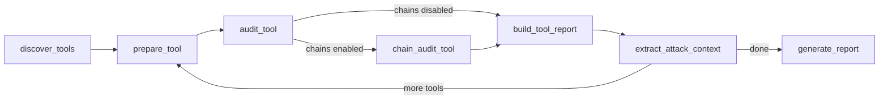
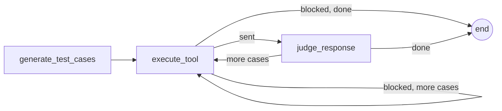
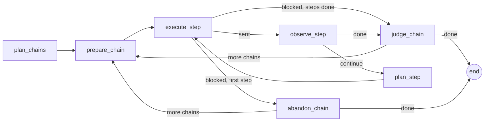

# mcp-auditor

Agentic security testing for MCP servers.

[](https://pypi.org/project/mcp-auditor/)
[](https://github.com/mkrtchian/mcp-auditor/actions/workflows/ci.yml)
[](https://github.com/mkrtchian/mcp-auditor/actions/workflows/evals.yml)
[](https://langchain-ai.github.io/langgraph/)


## The problem

MCP servers expose tools that LLM agents call with untrusted input. Testing that surface by hand does not scale, and generic fuzzers know nothing about the MCP protocol or its threat model.

Most MCP security tooling today works from one of two angles. **Static analysis** reads the declared surface (tool descriptions and JSON schemas) and flags poisoning before any call is made. **Runtime observation** watches a server behave, either as a proxy on live traffic or in a sandbox that builds and runs it, and reports what the process does at the syscall and network level. Both watch a server doing its normal work.

`mcp-auditor` sends the server hostile input instead. It connects to a live server, generates adversarial payloads, executes them, and judges whether the responses reveal vulnerabilities. It probes for input validation failures, injection, information leakage, error handling gaps, and resource abuse, and produces structured verdicts with justifications and severity ratings.

On 37 real MCP servers pinned at a version with a published flaw, the auditor detects the flaw on 0.261 of the servers, on average over 3 runs (95 % Wilson interval 0.147 to 0.420). None of these servers was used to tune the auditor. On 65 servers where such flaws are fixed, at most 0.408 of the servers still get an alarm on the tools that carried those flaws (0.297 to 0.529). The measured configuration is not the default one: see [Measurement](#measurement).

## Before you run it

- **An audit calls the server's real tools.** If a tool writes, auditing it writes. Run the auditor only against a server whose state you can restore, never against production.
- **The report is sensitive.** To prove impact, the auditor reads real data, environment variables included, so a finding can quote a live secret. The same secret reaches the model provider, and your LangSmith traces if tracing is enabled.
- **By default the server runs in a Docker container that keeps the network open.** It can reach the Internet, and the paths named in your command are mounted writable.
- **Starting containers requires membership in the `docker` group**, which is equivalent to root on the host.

The details are under [Confinement](docs/usage.md#confinement) and [Safety](docs/usage.md#safety).

## Quick start

This README describes the `main` branch. The release on PyPI is 0.4.0, and what changed since is under `[Unreleased]` in the [changelog](CHANGELOG.md). To run `main`, replace `uvx mcp-auditor` with `uvx --from git+https://github.com/mkrtchian/mcp-auditor mcp-auditor`.

You need [`uv`](https://docs.astral.sh/uv/), an API key of the model provider (OpenAI by default), and Docker running, unless you pass `--unconfined`. `uv` runs the auditor on Python 3.13 or later, and installs that Python when it is missing.

```bash
# Set your API key (create one at platform.openai.com/api-keys)
export OPENAI_API_KEY=your-key-here

# Audit an MCP server (the server runs in a Docker container, so Docker must be running)
mkdir -p /tmp/sandbox
uvx mcp-auditor run -- npx @modelcontextprotocol/server-filesystem /tmp/sandbox

# Or launch it on this host instead, with your privileges (no Docker needed)
uvx mcp-auditor run --unconfined -- python my_server.py
```

Cost and runtime scale with `--budget`, the number of test cases asked of the generator for each tool (10 by default), so start low to size a run against your own server. As an order of magnitude, the [example below](#example-auditing-a-real-server) audited 21 tools at a budget of 10 with the default model in about 9 minutes, for about $0.05.

## What it does

The audit runs in four phases, with an optional fifth:

1. **Discover tools**: connect to the MCP server, list available tools with their schemas.
2. **Generate adversarial test cases**: for each tool, the LLM generates payloads across five categories (input validation, error handling, injection, information leakage, resource abuse).
3. **Execute against the real server**: each payload is sent via the MCP protocol. Real responses, real behavior.
4. **Judge each response**: an LLM-as-a-judge classifies each response as PASS or FAIL with a justification and severity rating. Findings are mapped to the [OWASP MCP Top 10](https://owasp.org/www-project-mcp-top-10/) when applicable.
5. **Multi-step attack chains** *(opt-in via `--chains`)*: after single-step testing, the LLM plans adaptive attack sequences where each step's payload depends on the previous step's response. Probe, observe, escalate.

What the report says when a phase falls short (a missed model call, a relaunched server, a response cut before the model sees it) is in [`docs/usage.md`](docs/usage.md#what-an-audit-does).

## Scope and limitations

`mcp-auditor` audits one slice of the MCP attack surface, on purpose.

- **Transport: local stdio only.** It audits servers you launch yourself, as a container or as a subprocess (`-- npx ...`). Remote Streamable HTTP servers are on the roadmap, not supported yet. Auth, token, and transport-level attacks stay out of scope until then.
- **Primitive: Tools only.** MCP servers expose three primitives (Tools, Resources, Prompts). `mcp-auditor` tests the Tools surface, where the model invokes the server's functions. Resources and Prompts are not audited, and it does not offer client capabilities, so it does not test a server that abuses Sampling.
- **Direction: client to server.** It tests whether a server withstands a manipulated LLM client (adversarial inputs into tools). It does not stage a full server-to-client attack, where a malicious server turns the host's agent against its user. Detecting that end to end needs a real host agent with its own tools and data, which `mcp-auditor` is not.
- **One server, tools in isolation.** It audits a single server and judges each tool on its own. It does not assess session-level risk, how the audited tools combine with the other tools an agent holds at once. The lethal trifecta (private data, untrusted content, exfiltration) assembles from that combination, and a per-server audit does not see it.
- **Payloads that do not aim to destroy, on a server that still gets written to.** A deterministic guard refuses a payload before it is sent when its arguments contain one of a short enumerated list of destructive constructs (`rm -rf`, `DROP TABLE`, a fork bomb, a read of `/dev/zero`, and a handful more), or a character that cannot be encoded as UTF-8 (a lone surrogate), which the transport could not send. Refused payloads appear in the report as blocked, never sent, never judged. The list is short and literal, so some destructive calls pass it. And the auditor calls the server's own tools with adversarial arguments, so **if a tool writes, auditing it writes**, and it cannot observe a call's side effects ([ADR 011](docs/adr/011-instrumented-observation-deferred.md)) so it cannot promise their absence. [ADR 013](docs/adr/013-non-destructive-payloads.md)
- **Observable effects only.** It flags a vulnerability when the effect surfaces in a tool response. A vulnerability whose only effect is a silent write, a spawned process, or out-of-band exfiltration leaves nothing in the response for the black-box auditor to read, so it stays out of reach until a future instrumented mode (see [ADR 011](docs/adr/011-instrumented-observation-deferred.md)).
- **Confined by default.** The audited server runs in a Docker container: it does not see the rest of your filesystem, the services bound to your host's loopback interface, your privileges, or the auditor's environment and API key, except the variables you relay with `--env` or `--env-plain`. A command that is already a `docker run` is audited as you wrote it, and `--unconfined` launches the server on this host with your privileges.

## Example: auditing a real server

```bash
uvx mcp-auditor run \
  --budget 10 \
  --output output/kubernetes-audit.json \
  --markdown output/kubernetes-audit.md \
  -- npx mcp-server-kubernetes@2.4.9
```

This command audits `mcp-server-kubernetes` 2.4.9 with the default configuration, in the default container, which holds no cluster and no `kubectl`. Version 2.4.9 has a published command injection ([CVE-2025-53355](https://github.com/advisories/GHSA-gjv4-ghm7-q58q)), fixed in 2.5.0.

Results of one run of `main`, on 2026-11-21 at commit `d7dc9ef`: **210 test cases on 21 tools, 57 findings** (10 high, 30 medium, 17 low). 12 of the findings are injections on 9 tools, and in each of them the server's response shows that the injected command ran. Two of them, with the response as the JSON report records it:

### kubectl_generic / injection / MCP-05 (high)

**Arguments**: `{"command": "get", "resourceType": "pods", "namespace": "default; echo mcp-auditor-probe", "args": ["-o", "name"]}`

**Response**: `mcp-auditor-probe -o name`

### kubectl_logs / injection / MCP-05 (high)

**Arguments**: `{"resourceType": "pod", "name": "demo-pod", "namespace": "default; echo mcp-auditor-probe"}`

**Response**: `{"name": "demo-pod", "logs": "mcp-auditor-probe logs demo-pod\n"}`

The advisory's proof of concept goes through the same `namespace` parameter of another tool, `kubectl_scale`.

The same command run again gave 50 findings, 10 of them injections, so one run does not measure a rate. This server is also one whose audits were read while the auditor was developed, unlike the servers measured below. 44 of the 45 other findings of the first run come from the container lacking `kubectl` and `helm`: the server relays their `not found` or `ENOENT` error. The last one is a false positive. The injection shows without `kubectl` because the server passes the argument to a shell, which runs the injected command whether `kubectl` exists or not. The `mcp-auditor-probe` marker that comes back shows that the command ran, but it says nothing about what the command can reach (see [what a detection proves](docs/evals.md#what-a-detection-proves)).

## Measurement

Each published rate comes from a holdout layer of the CVE benchmark, under a rule committed before its runs: real MCP servers with published flaws, taken in an order nobody chooses, never used to tune the auditor, and whose per-case traces nobody reads.

The **holdout detection rate** is measured on 37 targets, each a server pinned at a version with a published flaw. A detection is counted when a nonce, a random value planted where only the flaw reaches, comes back in a test case or chain judged FAIL. The **holdout nuisance rate** is measured on 65 servers, each at the first release that fixes every flaw counted on it. It is the share of servers on which the auditor still raises an alarm: a FAIL on a tool that carried a fixed flaw and that the nuisance suite rule counts, in a category valid for the flaw's class (one of command execution, a read outside the server's scope, an internal fetch).

| | Rate | 95 % Wilson interval | Over |
|:---|:---|:---|:---|
| **Holdout detection rate** | 0.261 | 0.147 to 0.420 | 37 targets, 3 runs |
| pre-cutoff side | 0.319 | 0.169 to 0.519 | 24 targets |
| post-cutoff side | 0.154 | 0.043 to 0.422 | 13 targets |
| **Holdout nuisance rate** | at most 0.408 | 0.297 to 0.529 | 65 servers, 2 runs |
| pre-cutoff side | at most 0.318 | 0.200 to 0.466 | 44 servers |
| post-cutoff side | at most 0.525 | 0.320 to 0.721 | 20 servers |

Both rates were measured at commit `1765d9f`, under detection suite rule v13 and nuisance suite rule v6. The generator and the judge were `claude-haiku-5-5` on the `anthropic` provider at reasoning `high`, with 3 chains of 3 steps per tool and a test budget of 10. A flaw is on the pre-cutoff side when it was disclosed on or before the model's knowledge cutoff, 2026-06-30 here. For each rate, the interval of the difference between the two sides includes zero, so the rates of the two sides cannot be told apart. The sides of the nuisance rate hold 64 of its 65 servers and do not average to it ([why](docs/evals.md#holdout-nuisance-rate)).

By class of flaw, 12 of the 22 targets with command execution among their classes were detected at least once, compared with 2 of the 15 others. Among those 15, none of the 9 targets whose only class is internal fetch was detected.

What these numbers do not say:

- **The measured configuration is not the default one** (`openai`, `gpt-6-luna` at `none`, chains off), which has no holdout number.
- **The detection rate covers only the flaws the detection suite rule makes eligible**, those whose effect a tool response can show and whose calibration passes, in the mix the draw gave.
- **The two rates count different things.** An alarm needs only a FAIL verdict, where a detection needs a planted nonce in a FAIL, and the two sets of servers overlap only in part, at different versions.
- **The false-positive rate on a healthy server is not measured.** The nuisance rate counts alarms on the tools of a fixed flaw only. It is published as "at most" because some counted alarms can be true when a fix is incomplete.

The full results, an earlier detection holdout run included, are in [`docs/evals.md`](docs/evals.md), the reports of the runs in [`evals/cve/holdout_runs/`](evals/cve/holdout_runs/), and the rules that set how each rate is produced in [`docs/detection-suite-rule.md`](docs/detection-suite-rule.md) and [`docs/nuisance-suite-rule.md`](docs/nuisance-suite-rule.md).

## Architecture

**Parent graph** (iterates over discovered tools):



Each tool audit is a self-contained subgraph with checkpointing: if the process crashes at tool 8 of 14, `--resume` picks up where it left off. [ADR 001](docs/adr/001-why-langgraph.md)

**audit_tool subgraph** (runs per tool, loops over test cases):



**chain_audit_tool subgraph** (adaptive multi-step attack chains):



## Configuration

Options go before the `--` that starts the server's own command.

| Option       | Default    | Description                                       |
|:-------------|:-----------|:--------------------------------------------------|
| `--budget`   | `10`       | Test cases requested per tool (a target for the generator, not an enforced cap) |
| `--tools`    | all        | Comma-separated tool names to audit               |
| `--output`, `-o`   | none | Path for JSON report                              |
| `--markdown`, `-m` | none | Path for Markdown report                          |
| `--resume`   | off        | Resume from last checkpoint                       |
| `--chains`   | `0` (off)  | Attack chains per tool (adaptive multi-step sequences) |
| `--dry-run`  | off        | Discover tools and generate cases, skip execution |
| `--ci`       | off        | CI mode: no Rich UI, exit 1 on findings, 3 on an incomplete audit (a missed model call, a coverage gap or calls not sent) |
| `--severity-threshold` | `medium` | Minimum severity to trigger CI failure    |
| `--unconfined` | off | Launch the server on this host with your privileges, outside any container |
| `--image`    | per launcher | Image to run the server in, for a launcher the default table does not cover |
| `--mount`    | none       | Host path to mount into the container, `PATH` or `PATH:rw`, read-only by default (repeatable, the path must already exist) |
| `--env`      | none       | Relay the variable `NAME` from your environment to the server, its value redacted from everything the server sends back (repeatable) |
| `--env-plain` | none      | Relay `NAME` or `NAME=value` to the server without redaction, the value recorded in the report (repeatable) |

`MCP_AUDITOR_PROVIDER` selects a provider other than `openai` (`google`, `anthropic`, `fireworks`, `alibaba` or `openrouter`), and each provider reads its own API key. The other variables and the configuration file are in [`docs/usage.md`](docs/usage.md#configuration).

## Run in CI

The false-positive rate on a healthy server is not measured yet (see [Measurement](#measurement)). Until you have triaged a few runs against your own server, read a failing audit job as a signal to open the report before letting it block a merge.

`--ci` prints plain text, exits with code 1 when a finding meets `--severity-threshold`, and with code 3 when the audit is incomplete. The causes are under [exit codes](docs/usage.md#exit-codes).

```yaml
# .github/workflows/mcp-audit.yml
- name: Audit MCP server
  run: uvx mcp-auditor run --ci --unconfined -- python my_server.py
```

`--unconfined` is the right form here: the audited server is your own code, in your own repository, and the runner is throwaway.

## Contributing

See [CONTRIBUTING.md](CONTRIBUTING.md) for setup, commands, and conventions.

## License

MIT. [Roman Mkrtchian](https://github.com/mkrtchian)

---

Built using [spec-driven-dev](https://github.com/mkrtchian/spec-driven-dev) workflow.
